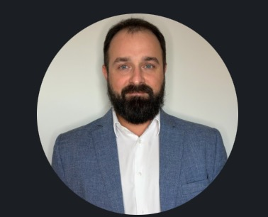

# Hey, I'm Rafał Będkowski 👋

**Products & Software Development Department Manager** @ [OPTOPOL Technology](https://optopol.com) — medtech / ophthalmic diagnostics
Certified Scrum Product Owner · CS Engineering student · Building [@drivetheproduct](https://instagram.com/drivetheproduct)

---

### What I'm into right now

- 🏥 Leading product & software development in a **regulated medtech environment** (MDR/IVD) — multidisciplinary team: biomedical engineers, clinical researchers, UX, statisticians
- 🤖 Exploring **AI agent architectures**, LLM orchestration, and agentic tooling — specifically what makes sense (and what doesn't) in clinical/medtech contexts
- 🧩 Working through the practical side: how AI fits into validated, traceable pipelines under MDR/IVD constraints
- 📱 Growing a PM/PO personal brand for people entering product roles → [@drivetheproduct](https://instagram.com/drivetheproduct)
- 🎓 Finishing B.Eng. in Computer Science @ Częstochowa University of Technology

---

### Stack & Tools

**Product:** Jira · Confluence · Figma · Miro
**AI & agents:** Claude · Perplexity · ChatGPT · NotebookLM
**Code:** Python · HTML/CSS · JS

---

### Let's connect

